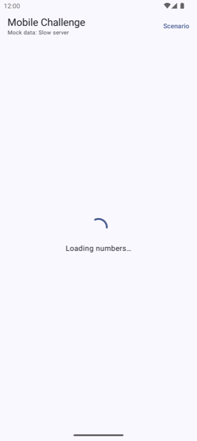
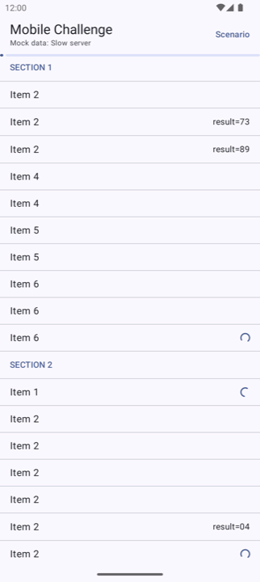
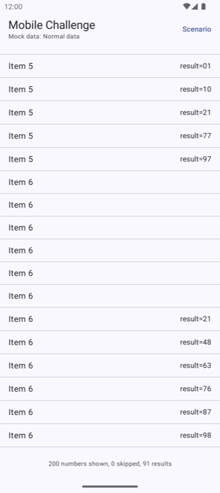
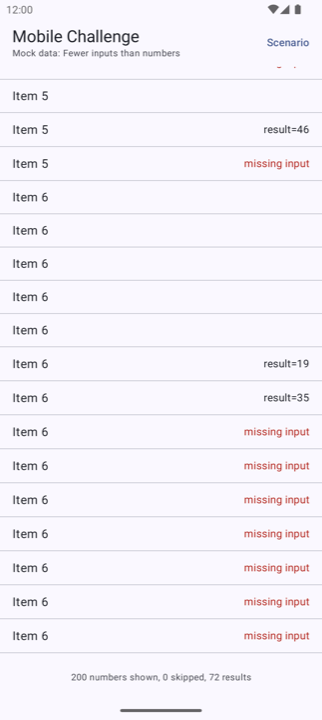
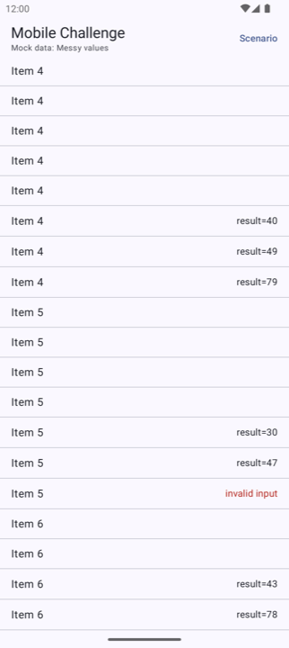
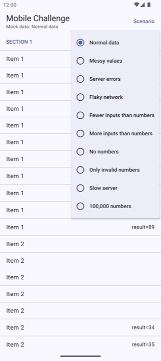
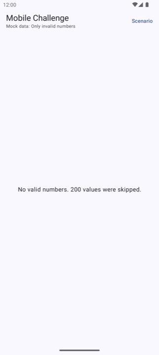
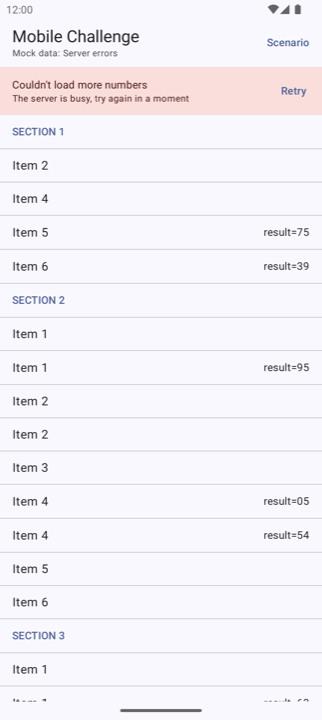
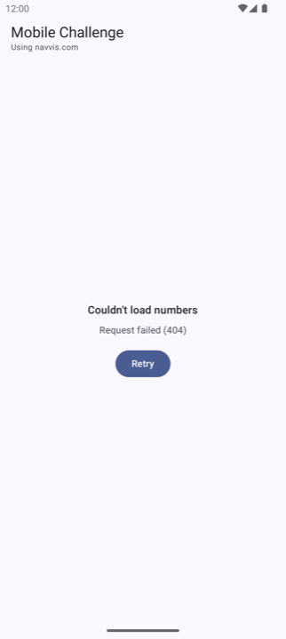

# NavVis mobile code challenge (Android)

My solution to the NavVis mobile code challenge. It's an Android app in Kotlin and Jetpack Compose that streams numbers and inputs from two endpoints, decodes the bits of each number, computes a result where one is needed, and shows everything grouped by section.

## Screenshots

NOTE: All screenshots are from the mock build, apart from the last one, which is the real build linked with the real endpoints provided by NavVis (they're not working as of now and return 404).

| Loading | Streaming | Done |
|---|---|---|
|  |  |  |

| Missing inputs | Invalid input | Scenario menu |
|---|---|---|
|  |  |  |

| No numbers | Only invalid numbers | Stream failed | Real build |
|---|---|---|---|
|  |  |  |  |

On a row, `result=NN` is a computed result, the small spinner means it's still loadins, and red text mentions if/why there is no result.

## Running it

You need a recent Android Studio (the project uses AGP 9.4, Kotlin 2.4 and compile SDK 37). Open the `mobile-challenge` folder.

There are two product flavors:

- `mock` uses fake endpoints from inside the app, so it works offline. This is the one you can try.
- `real` calls `https://navvis.com/numbers.json` and `https://navvis.com/inputs.json`. Both currently redirect to `www.navvis.com` and return 404, so this build shows the error screen when using this flavor.

Pick `mockDebug` or `realDebug` in the Build Variants panel, or from the command line:

```
cd mobile-challenge
./gradlew installMockDebug
./gradlew installRealDebug
```

Both can be installed at once. The mock one has the package name `com.navvistest.mobilechallenge.mock`.

In the mock build, the Scenario button in the top bar switches between ten sets of mock data. Picking one starts again from an empty list.

| Scenario | What it shows |
|---|---|
| Normal data | 200 valid numbers and inputs |
| Messy values | About a quarter of each stream is null, out of range, a string or a decimal |
| Server errors | A quarter of requests get a 503, a 429 or an HTML body |
| Flaky network | A quarter of requests time out or lose their connection |
| Fewer inputs than numbers | The last rows get "missing input" |
| More inputs than numbers | Extra inputs are ignored |
| No numbers | The empty state |
| Only invalid numbers | The empty state with a skipped count |
| Slow server | 1.5 to 2.5 s per response, to see the loading states |
| 100,000 numbers | The performance test |

## How it works

The app is one module with three layers.

- `data` makes the HTTP requests (OkHttp), decodes each array element on its own, and keeps asking an endpoint for the next chunk until it gets an empty array. Failed requests are retried with backoff. The mock server is an OkHttp interceptor in `data/mock`, so the mock build runs the same networking and decoding code as the real one.
- `domain` is the logic layer: `NumberParser` (the bit layout), `ResultComputer` (the slow computation, on background threads, with a timeout and a cache) and `SectionListBuilder` (grouping and sorting).
- `ui` has one ViewModel that collects both streams, pairs number `i` with input `i`, starts computations, and turns everything into a single `UiState`. The Compose screen just draws that state.

The list is rebuilt off the main thread at most every 100 ms, however fast data arrives. The first change shows at once.

[system-design.html](ai-knowledge-base/system-design.html) is the design I wrote before starting, with a diagram. The code follows it, with a few additions that were added later e.g. the sessions in the ViewModel for switching scenarios, the error views, and the scenario menu were not initially planned, but became part of the project later on.

## Assumptions

The challenge leaves a lot open on purpose. All my assumptions and the reasons for them are in [assumptions.md](ai-knowledge-base/assumptions.md). The main ones:

- Each request returns the next chunk, and the server remembers where each stream is. An empty array means that stream is done.
- Bits 0 and 1 are the section, bits 2 to 6 the item, bit 7 the result flag. Numbers that are null, outside 0 to 255, not whole, or have an item value of 6 or more are skipped, and the skipped count is shown.
- Inputs must be whole numbers from 0 to 65535. The result is `input % 100`, shown with two digits.
- Inside a section, rows are sorted by item, then: no result, results from low to high, pending, errors.
- A row without the result flag never shows an error, even if its input is broken.

## Errors handling

- One bad value in a chunk (a string, a decimal, null) only affects that row. The rest of the chunk is kept.
- A body that isn't JSON, or doesn't have the expected key, fails that request.
- Timeouts, dropped connections, bad bodies, 5xx and 429 are retried up to 3 times with exponential backoff and jitter. A 404 or other 4xx fails at once, since sending it again won't change the result.
- If the numbers stream fails before any row arrives, the whole screen shows the error and a Retry button. If a stream fails later, a banner appears above the rows instead. Retry carries on from where that stream stopped, so nothing is fetched twice.
- A computation that takes longer than 2 sec is stopped and the row says "timed out". Waiting for a free thread doesn't count towards the 2 sec.
- If the inputs stream ends before a row's index, that row says "missing input".

## Tests

33 unit tests that and I only wrote tests for notable features:

| Test class | Tests | What it checks |
|---|---|---|
| `NumberParserTest` | 5 | The challenge's example numbers, edge bytes, out-of-range values, items without a title |
| `SectionListBuilderTest` | 4 | The challenge's example layout, section order, result order, ties |
| `ResultComputerTest` | 5 | Two-digit formatting, invalid inputs, the timeout, the cache, queued jobs not timing out |
| `ChunkDecoderTest` | 4 | Mixed good and bad elements, missing key, body that isn't JSON |
| `StreamApiTest` | 3 | 503, timeout and dropped connection become typed errors |
| `StreamRepositoryTest` | 5 | Stops on an empty array, retries, gives up, doesn't retry a 404, resumes at the right index |
| `MockInterceptorTest` | 2 | The real API and repository against the mock, including with lots of failed requests |
| `UiStateTest` | 5 | Which screen state is picked for each mix of rows and stream status |

There are no UI tests. The screens were checked by hand on an emulator and a phone, and the screenshots above are from those runs.

## Performance

Full numbers and method are in [performance.md](ai-knowledge-base/performance.md). TLDR is that, from the "100,000 numbers" scenario on a Sony Xperia 1 IV (with a 120 Hz screen), using the `mockBenchmark` build and flinging the list while it streams:

| | Janky frames (3 runs) | 99th percentile frame |
|---|---|---|
| Before the fix | 13.8%, 10.1%, 10.1% | 53 to 121 ms |
| After | 1.1%, 0.8%, 2.2% | 31 to 46 ms |

The fix was a one-liner: the list called `item()` for every row, which with 100,000 rows meant 100,000 calls on the main thread per update. It now calls `items()` once per section.

The first rows show after about 0.25 s and both streams finish in 15 to 18 s. Computing all results takes 86 to 96 s, which is almost all the simulated algorithm: about 50,000 computations, some of them deliberately slow outliers, 7 at a time. The screen stays smooth while that runs.

To measure it yourself, install `mockBenchmark` (release settings, signed with the debug key), pick "100,000 numbers" and run `adb logcat -s StreamTiming`.

## Shortcuts

Things that I kept simple, and what I'd do with more time:

- The server is assumed to remember each stream's position. If a response is lost after the server moved on, those values are gone, and if the app is killed the data can't be fetched again. An `offset` parameter on both endpoints would fix both.
- Leaving the screen and coming back in the same process continues the existing streams instead of starting over. That keeps numbers and inputs paired correctly, but it would surprise a user. Fix would be similar to the above one case.
- The mock code ships inside the real APK, unused. Moving it to a `src/mock` source set would keep it out of the real build.
- The whole list is re-sorted every 100 ms while data arrives. It's fast enough for 100,000 rows, but inserting new rows into already sorted sections would scale better.
- Two rows with the same input that start at the same moment both run the computation. The cache only helps once one finishes. Caching the in-progress job would fix it.
- The scenario names in the debug menu aren't translated. They only exist in the mock build.
- The theme is still the default Material one. I would probably make the design more appealing, and following NavVis theme.

## How I used AI

I used Claude Code (Anthropic's coding assistant, running in VS Code) for most of this project.

I made the calls on scope and the development process: Android only, mocking the endpoints, the branch and commit rules, writing tests only for the logic that matters. Claude drafted the planning documents (assumptions, system design, tickets) based on some initial back and forth and I edited them. For each ticket, Claude wrote the code and tests, ran them, and checked the app on an emulator or my phone. I reviewed every change before it was committed, often changed comments or code where needed, and asked questions about anything I didn't understand until I could explain it myself.

Some places where my review changed things are: I asked for a `MutableStateFlow` instead of a conflated channel for the rebuild signal, because I knew it better and wanted to be able to defend it. I asked for the simulated algorithm to be renamed. The crash in `StreamApi` (closing an HTTP response on the main thread) only showed up when testing on a device, about one launch in two. The computation timeout counting time spent in the queue was found by doing the arithmetic for 100,000 inputs before wiring results in.
